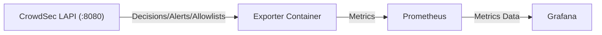
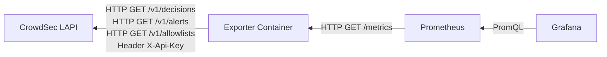

# Architecture

Data flow:

... and in direction of access:

The exporter polls the LAPI on every `/metrics` scrape request by Prometheus and yields fresh metrics each time.

# Metrics

## Decisions

| Metric                                                     | Type    | Labels                                                                                                       | Description                                    |
| ---------------------------------------------------------- | ------- | ------------------------------------------------------------------------------------------------------------ | ---------------------------------------------- |
| `crowdsec_decisions`                                       | Gauge   | `decisionType`, `origin`, `scenario`, `scope`                                                                | Currently active decisions aggregated by type  |
| `crowdsec_decisions_details`                               | Gauge   | `decisionType`, `origin`, `scenario`, `scope`, `val`, `decisionId`, `uuid`, `duration`, `until`, `simulated` | One entry per active decision with full detail |
| `crowdsec_decisions_fetched_total`                         | Counter | –                                                                                                            | Total decisions fetched since exporter start   |
| `crowdsec_last_successful_decision_poll_timestamp_seconds` | Gauge   | `endpoint`                                                                                                   | Unix timestamp of last successful poll         |

## Alerts

| Metric                                                   | Type    | Labels                                                                                                        | Description                                         |
| -------------------------------------------------------- | ------- | ------------------------------------------------------------------------------------------------------------- | --------------------------------------------------- |
| `crowdsec_alerts`                                        | Gauge   | `scenario`, `simulated`, `remediation`                                                                        | Currently active alerts aggregated by scenario      |
| `crowdsec_alerts_details`                                | Gauge   | `alertIdentifier`, `uuid`, `machineId`, `createdAt`, `scenario`, `country`, `ip`, `asName`, `decisionType`, … | One entry per alert with full geo and source detail |
| `crowdsec_alerts_fetched_total`                          | Counter | –                                                                                                             | Total alerts fetched since exporter start           |
| `crowdsec_last_successful_alerts_poll_timestamp_seconds` | Gauge   | `endpoint`                                                                                                    | Unix timestamp of last successful poll              |

## Allowlists

| Metric                                                       | Type    | Labels                                                                   | Description                                        |
| ------------------------------------------------------------ | ------- | ------------------------------------------------------------------------ | -------------------------------------------------- |
| `crowdsec_allowlists_items`                                  | Gauge   | `name`, `allowlistId`, `consoleManaged`                                  | Number of active (non-expired) items per allowlist |
| `crowdsec_allowlist_items_detail`                            | Gauge   | `allowlistId`, `name`, `value`, `description`, `expiration`, `isExpired` | One entry per allowlist item with expiry state     |
| `crowdsec_allowlist_expiring_items`                          | Gauge   | `name`, `allowlistId`, `consoleManaged`                                  | Items expiring within 24 hours                     |
| `crowdsec_allowlists_fetched_total`                          | Counter | –                                                                        | Total allowlists fetched since exporter start      |
| `crowdsec_last_successful_allowlists_poll_timestamp_seconds` | Gauge   | `endpoint`                                                               | Unix timestamp of last successful poll             |

## Exporter health

| Metric                       | Type    | Labels                   | Description               |
| ---------------------------- | ------- | ------------------------ | ------------------------- |
| `crowdsec_poll_errors_total` | Counter | `endpoint`, `error_type` | Failed LAPI poll attempts |
| `crowdsec_exporter_info`     | Info    | `version`, `git_commit`  | Build metadata            |

# Configuration (Environment variables)

| Variable                                    | Default         | Description                                                       |
| ------------------------------------------- | --------------- | ----------------------------------------------------------------- |
| `CROWDSEC_LAPI_URL`                         | none (required) | e.g. `http://crowdsec.crowdsec-monitoring.svc.cluster.local:8080` |
| `CROWDSEC_MACHINE_ID`                       | none (required) | used for OAuth login                                              |
| `CROWDSEC_MACHINE_PASSWORD`                 | none (required) | used for OAuth login                                              |
| `BIND_PORT`                                 | `8001`          | Bind port for the `/metrics` HTTP endpoint                        |
| `BIND_PORT`                                 | `0.0.0.0`       | Bind address for the `/metrics` endpoint                          |
| `LOG_LEVEL`                                 | `INFO`          | `DEBUG` / `INFO` / `WARNING` / `ERROR`                            |
| `CROWDSEC_LAPI_HTTP_TIMEOUT_SECONDS`        | `10`            | Timeout for HTTP communication with CrowdSec Local-API            |
| `METRICS_RETAIN_COUNTER_STARTUP_INCREMENTS` | `false`         | (or `true`) See [high cardinality](#high-cardinality) below       |
| `METRICS_COUNTER_MAX_COUNT`                 | `10000`         | See [high cardinality](#high-cardinality) below                   |
| `METRICS_COUNTER_MAX_AGE_SECONDS`           | `300` (5min)    | See [high cardinality](#high-cardinality) below                   |

## High Cardinality

The nature of this exporter is to display metrics about each individual CrowdSec alert.
Naturally, each metric that contains a `ip` label from the alerts will have very many distinct sets of labels.
So, the cardinality ("number of unique values for the label") is very high, for almost all labels of these metrics (eg. "source network", "kind of attack", "ban duration", ...).

Normally, prometheus is designed to handle metrics with a limited cardinality: it _usually_ expects each distinct labelset to remain present for a long time and produce a lasting time series.
But, alerts only exist at the very point in time when they occurr.
And it is rather unusual (although absolutely possible) for a single attacker to hit the firewall multiple times and thus produce a real time series (instead of a single "event"). This is most common when using a soft kind of remediation in the CrowdSec configuration (eg. captchas or time-limited bans).
When doing a hard kind of remediation (eg. longlasting IP blocking), a single attacker rarely produces more than one event. But even then this is still possible:
eg. when they perform a burst of requests that all get blocked by a HTTP-WAF (AppSec) inband, while the IP block will only eventually settle a few milliseconds later across the entire infrastructure.

This circumstance necessitates a unique problem to label retention for the CrowdSec exporter: they must be retained for some time, such that actual time series might eventually evolve, but the cardinality of the labelset must still stay somewhat limited, to not exhaust RAM (for buffering) and disk space
in the Prometheus TSDB for storing never-changing/useless samples.

This exporter solves that by employing a pruning technique: it deletes unique labelsets after a while and not reports back samples for them anymore.
This makes the counter-metrics (like "number of attacks per IP") appear "reset to zero".
Thus, it is the same scenario as if when the exporter restarts.

But then, the next sample (after restart or pruning) we will always want to treat as a differential increase, no matter the previous value in the Prometheus TSDB.
At this point, a simple `increase()` function in PromQL will not help, because it only computes a difference starting from the second sample (which may never occurr).
To solve this, the exporter injects a virtual "zero sample" in front of the actual first sample of a new distinct labelset: this will help Prometheus compute
correct differences for the PromQL "delta/increase/rate" functions.
So naturally, the first sample gets delayed by one scrape interval.

The `METRICS_RETAIN_COUNTER_STARTUP_INCREMENTS` controls whether this will also happen for the very first scrape after a restart of the exporter.
Setting it to `true` allows to load an initial increment, if the exporter gets installed significantly later than the CrowdSec instance itself.
Leaving it to the `false` default will cover quick restarts of the exporter where missing a few alerts is less critical than double-counting all of them.
