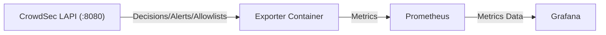
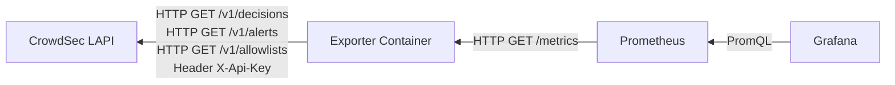

# Architecture

Data flow:

... and in direction of access:

The exporter polls the LAPI on every `/metrics` scrape request by Prometheus and yields fresh metrics each time.

# Metrics

## Decisions

| Metric                                                     | Type    | Labels                                                                                                       | Description                                    |
| ---------------------------------------------------------- | ------- | ------------------------------------------------------------------------------------------------------------ | ---------------------------------------------- |
| `crowdsec_decisions`                                       | Gauge   | `decisionType`, `origin`, `scenario`, `scope`                                                                | Currently active decisions aggregated by type  |
| `crowdsec_decisions_details`                               | Gauge   | `decisionType`, `origin`, `scenario`, `scope`, `val`, `decisionId`, `uuid`, `duration`, `until`, `simulated` | One entry per active decision with full detail |
| `crowdsec_decisions_fetched_total`                         | Counter | –                                                                                                            | Total decisions fetched since exporter start   |
| `crowdsec_last_successful_decision_poll_timestamp_seconds` | Gauge   | `endpoint`                                                                                                   | Unix timestamp of last successful poll         |

## Alerts

| Metric                                                   | Type    | Labels                                                                                                        | Description                                         |
| -------------------------------------------------------- | ------- | ------------------------------------------------------------------------------------------------------------- | --------------------------------------------------- |
| `crowdsec_alerts`                                        | Gauge   | `scenario`, `simulated`, `remediation`                                                                        | Currently active alerts aggregated by scenario      |
| `crowdsec_alerts_details`                                | Gauge   | `alertIdentifier`, `uuid`, `machineId`, `createdAt`, `scenario`, `country`, `ip`, `asName`, `decisionType`, … | One entry per alert with full geo and source detail |
| `crowdsec_alerts_fetched_total`                          | Counter | –                                                                                                             | Total alerts fetched since exporter start           |
| `crowdsec_last_successful_alerts_poll_timestamp_seconds` | Gauge   | `endpoint`                                                                                                    | Unix timestamp of last successful poll              |

## Allowlists

| Metric                                                       | Type    | Labels                                                                   | Description                                        |
| ------------------------------------------------------------ | ------- | ------------------------------------------------------------------------ | -------------------------------------------------- |
| `crowdsec_allowlists_items`                                  | Gauge   | `name`, `allowlistId`, `consoleManaged`                                  | Number of active (non-expired) items per allowlist |
| `crowdsec_allowlist_items_detail`                            | Gauge   | `allowlistId`, `name`, `value`, `description`, `expiration`, `isExpired` | One entry per allowlist item with expiry state     |
| `crowdsec_allowlist_expiring_items`                          | Gauge   | `name`, `allowlistId`, `consoleManaged`                                  | Items expiring within 24 hours                     |
| `crowdsec_allowlists_fetched_total`                          | Counter | –                                                                        | Total allowlists fetched since exporter start      |
| `crowdsec_last_successful_allowlists_poll_timestamp_seconds` | Gauge   | `endpoint`                                                               | Unix timestamp of last successful poll             |

## Exporter health

| Metric                       | Type    | Labels                   | Description               |
| ---------------------------- | ------- | ------------------------ | ------------------------- |
| `crowdsec_poll_errors_total` | Counter | `endpoint`, `error_type` | Failed LAPI poll attempts |
| `crowdsec_exporter_info`     | Info    | `version`, `git_commit`  | Build metadata            |

# Configuration (Environment variables)

| Variable                | Required | Default   | Description                                                       |
| ----------------------- | -------- | --------- | ----------------------------------------------------------------- |
| `CROWDSEC_LAPI_URL`     | ✓        | –         | e.g. `http://crowdsec.crowdsec-monitoring.svc.cluster.local:8080` |
| `CROWDSEC_API_KEY`      | ✓        | –         | Bouncer API key – read-only, injected via Kubernetes Secret       |
| `METRICS_PORT`          |          | `8000`    | Port for the `/metrics` HTTP endpoint                             |
| `METRICS_HOST`          |          | `0.0.0.0` | Bind address (NetworkPolicy restricts inbound)                    |
| `POLL_INTERVAL_SECONDS` |          | `60`      | Polling interval in seconds                                       |
| `LOG_LEVEL`             |          | `INFO`    | `DEBUG` / `INFO` / `WARNING` / `ERROR`                            |

