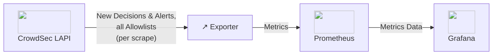
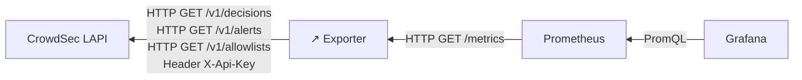
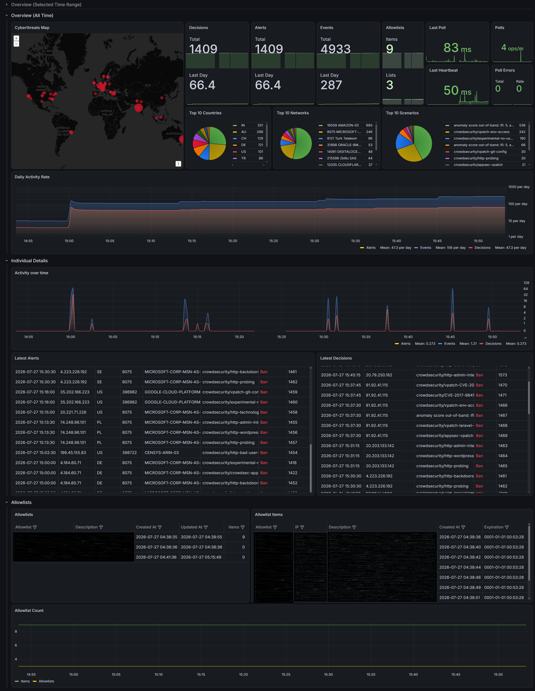

# Architecture

Data flow:

... and in direction of access

The exporter polls the LAPI on every `/metrics` scrape request by Prometheus and yields fresh metrics each time.

# Metrics

All metrics are prefixed with `crowdsec_`. The following table shows the most-relevant metrics. There are more: see [metric sets](#metric-sets)

| Metric                 | Type                              | Labels                                                               | Description                                                                                               |
| ---------------------- | --------------------------------- | -------------------------------------------------------------------- | --------------------------------------------------------------------------------------------------------- |
| alerts_grand_total     | counter                           | scenario, country, as_number, as_name                                | All-time total number of alerts _per labelset_. Most useful as `sum by (somelabel)(increase([$__range]))` |
| decisions_grand_total  | counter                           | scenario, country, as_number, as_name, origin                        | Like `alerts_grand_total`                                                                                 |
| events_grand_total     | counter                           | scenario, country, as_number, as_name                                | Like `alerts_grand_total`                                                                                 |
| alerts_total           | pruned counter                    | [see alert labelset](#full-alert-labelset)                           | A short-time counter, prefixed with a 0-sample upon reset, see [High Cardinality](#high-cardinality)      |
| decisions_total        | pruned counter                    | [see alert labelset](#full-alert-labelset)                           | Like `alerts_total`                                                                                       |
| events_total           | pruned counter                    | [see alert labelset](#full-alert-labelset)                           | Like `alerts_total`                                                                                       |
| allowlists_total       | counter                           |                                                                      | Number of created allowlists                                                                              |
| allowlists_items_total | counter                           |                                                                      | Number of created allowlists items                                                                        |
| allowlists             | info                              | allowlist_name, console_managed, description, created_at, updated_at | Details about the individual allowlists                                                                   |
| allowlist_items        | info                              | allowlist_name, value, description, created_at, expiration           | Details about the individual allowlist items                                                              |
| alerts                 | info (only new since last scrape) | [see alert labelset](#full-alert-labelset)                           | Details about the individual alerts                                                                       |
| decisions              | info (only new since last scrape) | [see decision labelset](#full-decision-labelset)                     | Details about the individual decisions of all alerts where `origin=crowdsec`                              |

## Full Alert Labelset

| Label            | On Counters? | Description                                                 |
| ---------------- | ------------ | ----------------------------------------------------------- |
| id               | -            | Simple, incrementing counter inside LAPI                    |
| uuid             | -            | Random UUID, assigned during alert creation                 |
| machine_id       | -            | Which CrowdSec machine identified the attack                |
| scenario         | yes          | Scenario name that triggered the alert                      |
| scenario_hash    | yes          | Scenario Hash/ID that triggered the alert                   |
| scenario_version | yes          | Version of the scenario                                     |
| simulated        | yes          | Maps to the "simulated"-flag in CS LAPI                     |
| remediation      | yes          | `true/false` the attack was remediated immediately          |
| ip               | yes          | The offender                                                |
| subnet           | yes          | The subnet to which the offender belongs                    |
| country          | yes          | The origin country of the offender                          |
| as_number        | yes          | The origin BGP AS Network Number (eg. ISP of the offender)  |
| as_name          | yes          | The origin BGP AS Network Name                              |
| latitude         | yes          | The inferred geoposition of the offender, based on their IP |
| longitude        | yes          | The inferred geoposition of the offender, based on their IP |
| decision_type    | yes          | eg. `ban` or `captcha` (of the first decision)              |
| decision_scope   | yes          | Either `Ip` or `Subnet` (of the first decision)             |

## Full Decision Labelset

| Label         | Description                                                                             |
| ------------- | --------------------------------------------------------------------------------------- |
| alert_id      | Alert from which the decision was derived, simple incrementing counter in LAPI instance |
| alert_uuid    | Alert from which the decision was derived                                               |
| decision_id   | Simple incrementing counter in LAPI instance                                            |
| decision_uuid | Like `alert_uuid`, pendant to `decision_id`                                             |
| type          | eg. `ban` or `captcha`                                                                  |
| origin        | Either `crowdsec` or `CAPI`                                                             |
| scope         | Either `Ip` or `Subnet`                                                                 |
| value         | The offending IP address or subnet in CIDR notation                                     |
| duration      | eg. `4h30m` how long the decision will be effective                                     |
| until         | ISO8601 timestamp of when the decision will be discarded (ie. "creation" + "duration")  |
| simulated     | Whether the decision originated from a simulated alert                                  |

## Metric Sets

This exporter produces a possibly huge number of metrics with different levels of relevancy. For basic needs, a smaller subset of metrics usually suffices.
By setting the env var `METRIC_SETS` to a comma-separated list of the following items, one can choose from the following list.
Additionally, one can restrict the returned metrics even further, by supplying the `name[]` URL query parameter during scrapes, to denote the desired individual metric names (see [prometheus client library docs](https://pkg.go.dev/github.com/prometheus/client_golang/prometheus/promhttp#Handler)).

| Set                   | Metrics                                                                                                   |
| --------------------- | --------------------------------------------------------------------------------------------------------- |
| `all`                 | Alias to disable filtering                                                                                |
| `basic`               | Alias for `exporter, grand_totals, allowlist_totals`                                                      |
| `default`             | Alias for `exporter, grand_totals, totals, instances, allowlist_totals, allowlist_instances`              |
| `exporter`            | Information about the exporter itself (eg. `crowdsec_exporter_info` and the python-internal metrics)      |
| `grand_totals`        | The never-pruned totals for decisions, alerts and events.                                                 |
| `totals`              | The pruned totals for decisions, alerts and events.                                                       |
| `instances`           | The pruned type=info metrics for new decisions, alerts and events, since the last scrape.                 |
| `details`             | Additional metrics for the `instances`, like eg. `alert_created` and `alert_events_count`.                |
| `allowlist_totals`    | Counters about the allowlists                                                                             |
| `allowlist_instances` | The current info gauges for allowlists and their items.                                                   |
| `allowlist_details`   | More details about the allowlists and items, like eg. `allowlist_created` or `allowlist_item_expiration`. |

As a third measure, the helm chart drops metrics that are unused by the [grafana dashboard](./src/main/grafana/dashboard.json), by default.
You can restore them by `prometheus.metricRelabelings: []`.

# Configuration (Environment variables)

| Variable                                    | Default      | Description                                                          |
| ------------------------------------------- | ------------ | -------------------------------------------------------------------- |
| `CROWDSEC_LAPI_URL`                         | (required)   | e.g. `http://crowdsec.crowdsec-monitoring.svc.cluster.local:8080`    |
| `CROWDSEC_MACHINE_ID`                       | (required)   | Used for OAuth login. Can be `file:/etc/somefile` to read from there |
| `CROWDSEC_MACHINE_PASSWORD`                 | (required)   | Used for OAuth login. Can be `file:/etc/somefile` to read from there |
| `BIND_PORT`                                 | `8001`       | Bind port for the `/metrics` HTTP endpoint                           |
| `BIND_HOST`                                 | `0.0.0.0`    | Bind address for the `/metrics` endpoint                             |
| `LOG_LEVEL`                                 | `INFO`       | `DEBUG` / `INFO` / `WARNING` / `ERROR`                               |
| `CROWDSEC_LAPI_HTTP_TIMEOUT_SECONDS`        | `10`         | Timeout for HTTP communication with CrowdSec Local-API               |
| `CROWDSEC_LAPI_BATCH_SIZE`                  | `10000`      | Number of elements to download from LAPI with a single http request  |
| `METRICS_RETAIN_COUNTER_STARTUP_INCREMENTS` | `false`      | (or `true`) See [high cardinality](#high-cardinality) below          |
| `METRICS_COUNTER_MAX_COUNT`                 | `10000`      | See [high cardinality](#high-cardinality) below                      |
| `METRICS_COUNTER_MAX_AGE_SECONDS`           | `300` (5min) | See [high cardinality](#high-cardinality) below                      |
| `ALERT_DEDUP_WINDOW_SIZE`                   | `50000`      | LRU cache size. Should be multiple times `CROWDSEC_LAPI_BATCH_SIZE`  |
| `METRIC_SETS`                               | `default`    | Comma-separated list. See [metric sets](#metric-sets).               |
| `TLS_CERT_FILE`                             | unset        | See [tls](#tls). Must be a path itself.                              |
| `TLS_KEY_FILE`                              | unset        | See [tls](#tls). Must be a path itself.                              |
| `TLS_KEY_PASSWORD`                          | unset        | See [tls](#tls). Can be `file:/etc/somefile` to read from there      |
| `AUTH_USERNAME`                             | unset        | See [auth](#auth). Can be `file:/etc/somefile` to read from there    |
| `AUTH_PASSWORD`                             | unset        | See [auth](#auth). Can be `file:/etc/somefile` to read from there    |
| `AUTH_BEARER_TOKEN`                         | unset        | See [auth](#auth). Can be `file:/etc/somefile` to read from there    |

## High Cardinality

The nature of this exporter is to display metrics about each individual CrowdSec alert.
Naturally, each metric that contains a `ip` label from the alerts will have very many distinct sets of labels.
So, the cardinality ("number of unique values for the label") is very high, for almost all labels of these metrics (eg. "source network", "kind of attack", "ban duration", ...).

Normally, prometheus is designed to handle metrics with a limited cardinality: it _usually_ expects each distinct labelset to remain present for a long time and produce a lasting time series.
But, alerts only exist at the very point in time when they occurr.
And it is rather unusual (although absolutely possible) for a single attacker to hit the firewall multiple times and thus produce a real time series (instead of a single "event"). This is most common when using a soft kind of remediation in the CrowdSec configuration (eg. captchas or time-limited bans).
When doing a hard kind of remediation (eg. longlasting IP blocking), a single attacker rarely produces more than one event. But even then this is still possible:
eg. when they perform a burst of requests that all get blocked by a HTTP-WAF (AppSec) inband, while the IP block will only eventually settle a few milliseconds later across the entire infrastructure.

This circumstance necessitates a unique problem to label retention for the CrowdSec exporter: they must be retained for some time, such that actual time series might eventually evolve, but the cardinality of the labelset must still stay somewhat limited, to not exhaust RAM (for buffering) and disk space
in the Prometheus TSDB for storing never-changing/useless samples.

This exporter solves that by employing a pruning technique: it deletes unique labelsets after a while and not reports back samples for them anymore.
This makes the counter-metrics (like "number of attacks per IP") appear "reset to zero".
Thus, it is the same scenario as if when the exporter restarts.

But then, the next sample (after restart or pruning) we will always want to treat as a differential increase, no matter the previous value in the Prometheus TSDB.
At this point, a simple `increase()` function in PromQL will not help, because it only computes a difference starting from the second sample (which may never occurr).
To solve this, the exporter injects a virtual "zero sample" in front of the actual first sample of a new distinct labelset: this will help Prometheus compute
correct differences for the PromQL "delta/increase/rate" functions.
So naturally, the first sample gets delayed by one scrape interval.

The `METRICS_RETAIN_COUNTER_STARTUP_INCREMENTS` controls whether this will also happen for the very first scrape after a restart of the exporter.
Setting it to `true` allows to load an initial increment, if the exporter gets installed significantly later than the CrowdSec instance itself.
Leaving it to the `false` default will cover quick restarts of the exporter where missing a few alerts is less critical than double-counting all of them.

## CAPI decisions

The cardinality is even worse for the metric `crowdsec_decisions{origin="CAPI"}`, because a single alert (the "CAPI update"-alert) will produce many thousands of decisions.
Tracking these individually is almost never interesting, but it severely explodes the cardinality of the metric (from a few houndred local decisions per day to many thousands upon every CAPI-poll cycle).
Thus, this exporter explicitly filters out CAPI-originated decisions.

If you want to retain them, set `METRICS_RETAIN_CAPI_DECISIONS=true`. You should only do this in development environments, eg. to get a feel of that data.
The Prometheus instance of any reasonably-sized production environment will likely die from the amount of data you get from this.

The exporter will still yield `crowdsec_decisions_total` and `crowdsec_decisions_grand_total` for the "CAPI update"-alerts.
Yet, since the `Alert.source.ip` is reported by CrowdSec LAPI as `unknown` there, the cardinality collapses to 1 for these cases.

Hint: you can also enable exporting these decisions and then have a `Values.prometheus.serviceMonitor.metricRelabelings` config to drop them (by default, the Helm chart drops `crowdsec_decisions_total` and `crowdsec_events_total` via `metricRelabelings` as the bundled Grafana dashboard only queries `crowdsec_alerts_total`).
Since this then still transmits these metrics across the network, it is usually more performant to filter them out in this exporter already.
But the export-then-relabel-to-drop approach can be helpful when consuming the exporter from multiple prometheus instances with different levels of target granularity.

## TLS

The exporter can serve via TLS, such that the metrics about the firewall stay secure during transit.
When enabling this, properly trusted TLS certificates should be used to prevent MITM-attacks.
The private key (`TLS_KEY_FILE`) can optionally be encrypted using a given password (`TLS_KEY_PASSWORD`).

When switching to TLS, the `BIND_PORT` will be wrapped by a TLS encryption (ie. no plain-http connectivity anymore).

This setting is strongly recommended, when enabling [auth](#auth).

## Auth

The exporter can optionally require authentication, either via HTTP BasicAuth (Header `Authorization: Basic base64(username:password)`) or via an Bearer-Token (Header `Authorization: Bearer ...`).
The associated configuration variables are mutually exclusive.
This setting is recommended to only be used with [tls](#tls), for obvious reasons.

# Dashboard

You can get a Grafana dashboard from [here](./src/main/grafana/dashboard.json).
It looks roughly like this:

